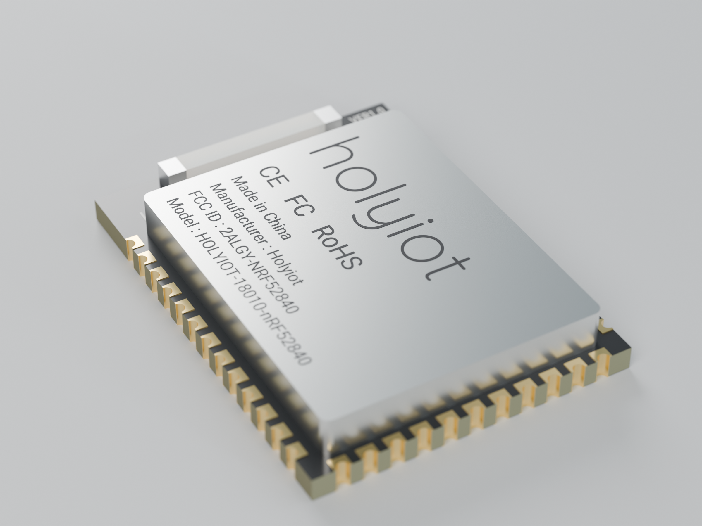
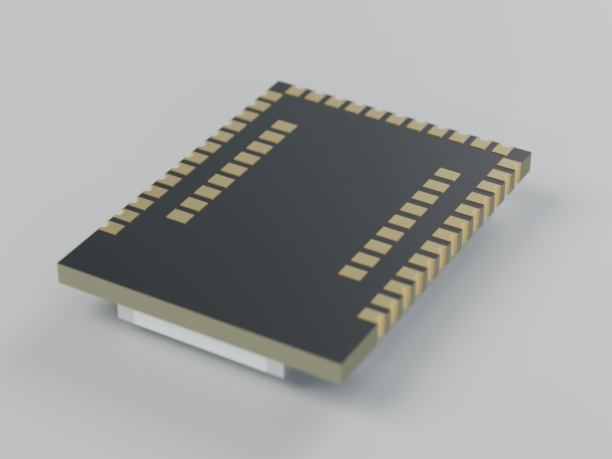
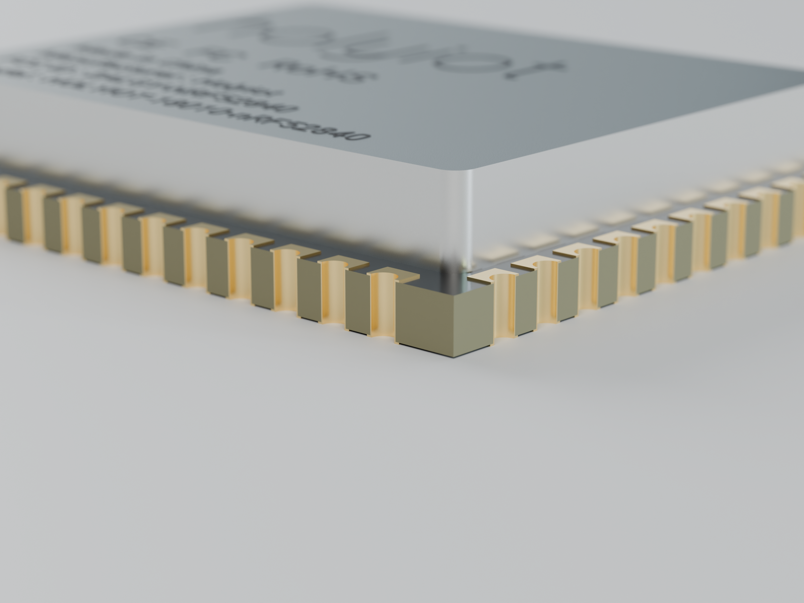
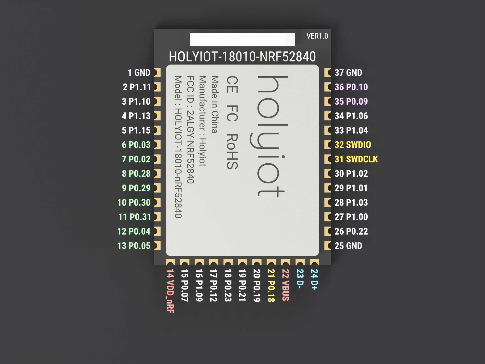
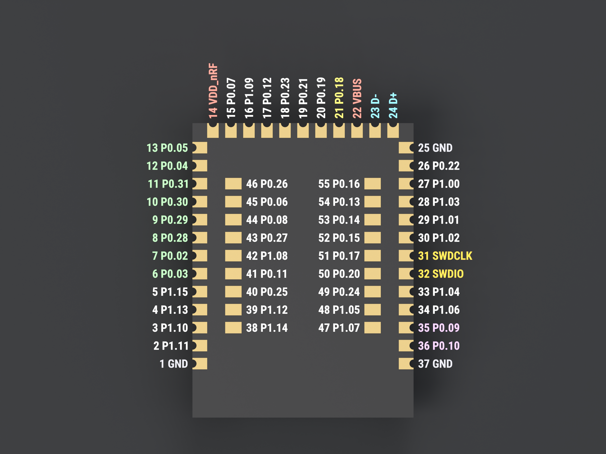

# Holyiot-18010 (nRF52840) module - parametric FreeCAD model

Parametric FreeCAD model of the [Holyiot-18010](http://www.holyiot.com/tp/2019042516322180424.pdf) nRF52840 BLE module, for designing programming and test jigs.

<p>
  
  
  
</p>

## Accuracy

- Pad positions, the 1.1 mm pitch and the outline come from the datasheet's mechanical drawing.
- Pad sizes, the shield can and the antenna are measured from the [product photos](https://www.aliexpress.com/item/32951888809.html).
- Three heights are estimates: the datasheet omits them, and the vendor gives 2.7 mm in total. Measure your module and update these parameters before you print a jig:
  1. `BoardThickness`: PCB thickness, 1.0 mm in the model.
  2. `ShieldThickness`: shield can height above the PCB, 1.7 mm in the model.
  3. `AntennaThickness`: chip antenna height, 1.0 mm in the model.

Each parameter's tooltip in FreeCAD names its source: DS for the datasheet, PH for the photos, or ESTIMATE.

## Pinout

<p>
  
  
</p>

Left: top view. Right: bottom view, the side a jig touches.

Label colours: grey for GND, red for power, orange for SWD, yellow for nRESET (P0.18), blue for USB, purple for NFC, green for analog inputs and white for plain GPIO.

Pins for programming over SWD or USB:

| Pin | Name | Use |
| --- | --- | --- |
| 14 | VDD_nRF | Supply, 3.9 V max |
| 1, 25, 37 | GND | Ground |
| 31 | SWDCLK | SWD clock |
| 32 | SWDIO | SWD data |
| 21 | P0.18 | nRESET |
| 22, 23, 24 | VBUS, D-, D+ | USB, 5.8 V max on VBUS |

## Designing a jig with it

Open `Holyiot.FCStd` in FreeCAD 26.3 or newer.

- **Parameters** (`Params`) holds every dimension, including pad counts and pitch. Change a value and recompute; the model and `Pinout` follow. The Derived group is computed.
- **Pinout** is a spreadsheet with all 55 pins: number, name, function and the X/Y/Z centre of each bottom-face pad. Reference it from a jig sketch by expression, for example `Pinout.pin31_x` and `Pinout.pin31_y` for SWDCLK.
- The origin is the board centre. The PCB bottom face is at z = 0 and +Y points towards the antenna. Pin 1 is top-left when you look down on the shield.
- The model has one PartDesign Body per material, inside the `Holyiot-18010 nRF52840` part. The pin labels are in three groups: top view (shown), bottom view and an inner-pad overlay drawn above the shield (both hidden).

## Files

| Path | Contents |
| --- | --- |
| `Holyiot.FCStd` | The FreeCAD model. |
| `export/Holyiot-18010.step` | STEP AP242 for other CAD tools: an assembly of named, coloured parts. Geometry only, without pin labels and markings. |
| `fonts/` | Open-licensed fonts for the labels and markings. Keep this folder next to the `.FCStd`, because the text objects load fonts from `./fonts/`. |
| `materials/` | FreeCAD materials: FR-4, solder mask, ENIG gold, nickel silver, alumina ceramic, silkscreen, laser marking and silver. |
| `docs/` | Links to the datasheet and the product listing. |
| `renders/` | The images on this page and the GitHub social preview. |
| `printables.md` | Text for the Printables listing. |
| `tools/` | The scripts that build, export and render the model. |

Colours are stored in the `.FCStd`. For the physical material data (density, conductivity), set Preferences → Material → *Use materials from custom directory* to `materials/`.

## Rebuilding and rendering

`tools/build_model.py` generates the whole document, so changes to the model go into the script. Run it in FreeCAD's Python console with `Holyiot.FCStd` open:

```python
exec(open('/path/to/repo/tools/build_model.py').read())
```

It recreates every object it made, keeps your `Params` values, and saves. It clears expressions before deleting objects, to avoid [FreeCAD bug #33685](https://github.com/FreeCAD/FreeCAD/issues/33685).

The other scripts run the same way:

1. `tools/export_step.py` writes `export/Holyiot-18010.step`.
2. `tools/export_meshes.py` writes render meshes to `build/meshes/`.
3. `tools/render.py` renders them with Blender Cycles into `renders/`:

   ```sh
   blender -b --factory-startup --python tools/render.py -- --samples 384
   ```

   Add `--shots hero,pinout_top` for a subset, or `--samples 64 --scale 40` for a quick preview.
4. `tools/social_preview.py` (plain Python with Pillow) composes `renders/social_preview.png` for the GitHub social preview.

## License

[CC0 1.0](LICENSE) (public domain), except `fonts/`, which keeps the SIL Open Font License (see `fonts/README.md`).
